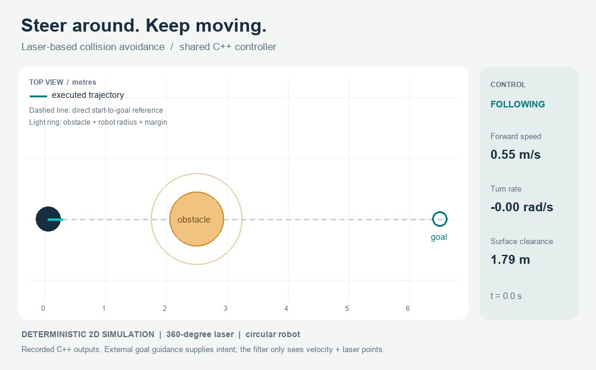

# Laser-based collision avoidance

**A ROS 1 velocity filter that steers around obstacles instead of only stopping.** It evaluates curved local trajectories against laser returns, keeps the robot's footprint clear, and follows the operator's requested motion whenever that motion is unobstructed.

Built in **C++** by **Lorenzo Soannini** as a robotics course project at **Sapienza University of Rome**, then revised with a testable controller, bounded commands, watchdogs, and a reproducible demo.



*Recorded outputs of the same C++ controller used by the ROS node, in a deterministic 2D simulator. This is not a Stage recording or a hardware test. An external goal-following policy supplies desired velocities; the avoidance filter receives only those velocities and simulated laser points.*

## How it works

```text
teleop / upstream controller ── cmd_vel_raw ──┐
                                            ├── collision avoidance ── cmd_vel ── robot
360-degree laser ── base_scan ── TF to base ──┘
```

At each update, the controller:

1. Keeps the requested velocity if its predicted arc has ample clearance.
2. Otherwise samples forward speeds and left/right turning rates over a 2.5-second horizon.
3. Rejects paths that intersect the circular footprint plus a safety margin, including allowances between rollout samples, for motion since scan acquisition, and for initial braking distance.
4. Scores the remaining arcs by progress, agreement with the requested motion, clearance, and steering consistency. A temporary bypass-side preference prevents left/right oscillation around centered obstacles.
5. Publishes a bounded command at 20 Hz. If no admissible forward arc exists, it can stop; missing, malformed, or stale input also produces zero velocity.

The filter does not know the destination. Returning toward a goal after a bypass is the responsibility of the teleoperator or upstream controller.

## Try it without ROS

A C++14 compiler and CMake 3.10+ are enough to build and test the controller on Linux or macOS:

```bash
git clone https://github.com/lorenzosoannini/LABIAGI_collision-avoidance.git
cd LABIAGI_collision-avoidance
cmake -S . -B /tmp/collision-build -DBUILD_ROS=OFF -DCMAKE_BUILD_TYPE=Release
cmake --build /tmp/collision-build --parallel 2
ctest --test-dir /tmp/collision-build --output-on-failure
/tmp/collision-build/simulate /tmp/single.csv single
```

Available scenarios: `single`, `offset`, `multiple`, and `clear`. Each simulation fails if it violates the 0.10 m surface-clearance threshold or cannot reach the goal within 80 simulated seconds. The scenario tests run the actual controller with a 360-ray scanner and differential-drive integration, rather than replaying a drawn path.

To recreate the GIF (Pillow is needed only for rendering):

```bash
python3 -m pip install -r tools/requirements.txt
/tmp/collision-build/simulate assets/trajectory.csv single
python3 tools/render_demo.py
```

The single-obstacle demo reaches the goal region in **13.3 simulated seconds**, with a minimum robot-to-obstacle surface clearance of **about 0.135 m**. These are idealized simulation results, not hardware performance guarantees. The full telemetry is in [assets/trajectory.csv](assets/trajectory.csv).

## Run with ROS 1

The integration target is **ROS Noetic on Ubuntu 20.04**. The package uses `roscpp`, `geometry_msgs`, `sensor_msgs`, `tf`, and `laser_geometry`. It retains ROS 1 to match the original project.

From an existing Noetic installation:

```bash
source /opt/ros/noetic/setup.bash
mkdir -p ~/catkin_ws/src
cd ~/catkin_ws/src
git clone https://github.com/lorenzosoannini/LABIAGI_collision-avoidance.git collision_avoidance
cd ~/catkin_ws
rosdep install --from-paths src --ignore-src -r -y
catkin_make -DCMAKE_BUILD_TYPE=Release
source devel/setup.bash
roslaunch collision_avoidance avoidance.launch
```

Start your simulator or robot driver separately. It must consume `cmd_vel`, publish `base_scan`, and provide the laser-to-`base_link` TF transform. The node requires near-360-degree scans (at least 6.18 rad), adequate range for its prediction horizon, and valid timestamps. A narrower scanner is rejected by this implementation.

Remap your command producer to **`cmd_vel_raw`**. For example, if the original keyboard teleop package is installed:

```bash
rosrun teleop_twist_keyboard_cpp teleop_twist_keyboard cmd_vel:=cmd_vel_raw
```

Publish commands continuously while driving; the last command expires after 0.5 s. Do not run another publisher directly into the robot's `cmd_vel` while using the filter. Input and output topics must differ; the node rejects configurations that resolve them to the same topic.

Topic and frame overrides are available in the launch file:

```bash
roslaunch collision_avoidance avoidance.launch \
  scan_topic:=scan base_frame:=base_link \
  input_topic:=cmd_vel_raw output_topic:=cmd_vel
```

### Test in Stage

A self-contained Stage world is included. Once the catkin workspace is built and sourced:

```bash
roslaunch collision_avoidance stage_demo.launch
```

This opens Stage with a small differential-drive robot, a 360-degree laser, and a box blocking the direct route. In another sourced terminal, run the automated goal-following trial:

```bash
rosrun collision_avoidance stage_trial.py --output /tmp/stage-trajectory.csv
```

A [verified CI execution](https://github.com/lorenzosoannini/LABIAGI_collision-avoidance/actions/runs/42095883863) reached the goal in **15.8 simulated seconds** (16.36 wall seconds), with **0.473 m minimum surface clearance**, checked over **317 ground-truth updates**. These are measurements from one execution, not fixed expected timing or path values. The [result metadata](docs/stage-validation.json) identifies the tested source commit; the [recorded Stage trajectory](assets/stage-trajectory.csv) is also included.

The upstream trial driver publishes desired commands to `cmd_vel_raw`; the avoidance node filters them; Stage consumes `cmd_vel` and produces the laser scans, TF and ground truth. The trial requires reaching the goal, deviating around the obstacle while moving, bounded output, and at least 0.095 m measured clearance (0.10 m nominal, with a 5 mm verification tolerance). It saves telemetry and a JSON result. These checks use the Stage robot's ground truth, rather than the standalone simulator's motion model.

For manual control, run keyboard teleop **instead of** the automated trial, remapped as shown above. For a machine without a display, use a virtual display while retaining Stage's GUI timing:

```bash
LIBGL_ALWAYS_SOFTWARE=1 xvfb-run -a roslaunch collision_avoidance stage_demo.launch
```

The world sets `speedup 1`, so simulation time follows wall time. Stage's `-g` mode (`gui:=false`) runs unthrottled and is unsuitable for this wall-timer controller; it is not used for the integration check. The CI Stage job uses Xvfb and uploads its log and telemetry as an artifact. A different Stage world can be selected with `world:=/absolute/path/to/file.world`. The automated trial's goal and obstacle-clearance checks are specific to the included world; use teleop or adapt the trial when changing the scene. Existing 270-degree laser worlds need a 360-degree laser configuration to meet the current node's coverage requirement.

### Main parameters

Defaults are in [config/default.yaml](config/default.yaml).

| Parameter | Default | Meaning |
| --- | ---: | --- |
| `robot_radius` | 0.20 m | Circumscribed footprint radius |
| `safety_margin` | 0.10 m | Additional obstacle clearance |
| `max_linear` | 0.60 m/s | Maximum forward speed |
| `max_angular` | 1.50 rad/s | Maximum turn rate |
| `horizon` | 2.50 s | Constant-command rollout horizon |
| `rollout_step` | 0.10 s | Prediction sample interval |
| `braking_deceleration` | 0.80 m/s² | Assumed available braking |
| `reaction_time` | 0.40 s | Braking allowance for sensing/control delay |
| `control_rate` | 20 Hz | Output publication frequency |
| `command_timeout` | 0.50 s | Maximum command receipt age |
| `scan_timeout` | 0.30 s | Maximum scan acquisition age |

`reaction_time` must cover `scan_timeout` plus one control period. Set footprint and braking parameters to match the actual base. Positive-infinite laser readings represent no return; NaNs, negative infinity, and below-minimum readings invalidate the scan. TF failures and expired commands/scans cause stop output. A wall-clock timer keeps the watchdog active when simulation time pauses.

## Validation and scope

The automated suite builds the standalone C++ controller, checks pass-through, steering, blocked/invalid inputs, command limits and watchdog logic, and runs all four navigation scenarios. A separate ROS Noetic job compiles the catkin package and exercises the real node with synthetic scans and command/scan timeouts. A third job runs the complete ROS + Stage closed-loop trial and uploads observed trajectory data.

This is a **local reactive controller**, not a complete navigation stack. It assumes a circular differential-drive robot, forward motion, static planar obstacles, and sufficiently dense laser returns. Reverse commands are rejected. Sampled obstacle points cannot establish that occluded or unobserved space is free, and a local bypass preference can get stuck in concave layouts. Actuator acceleration, wheel slip, moving obstacles, and real sensor noise are not modeled. A physical base still needs its own command-loss watchdog.

See the [code review and design notes](docs/review.md) for the changes from the original implementation and verification details.

## Repository

```text
include/collision_avoidance/  ROS-independent controller and watchdog
src/SimNode.cpp              ROS adapter: topics, TF, validation, timer
config/                     Controller parameters
launch/                     ROS node and Stage demo launch files
worlds/                     Self-contained Stage world
tests/                      C++ checks and ROS integration smoke test
tools/                      Deterministic simulator and GIF renderer
assets/                     Demo GIF, preview and recorded trajectory
docs/                       Review and design notes
```
